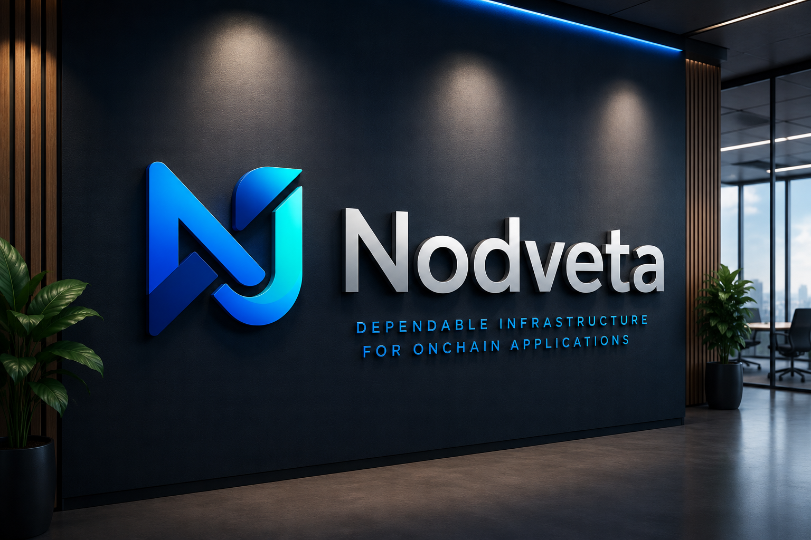

Nodveta

Dependable infrastructure for onchain applications.

Nodveta is a blockchain infrastructure company building reliable systems that connect production applications with blockchain networks.

The company was founded in September 2025 and began active operations in June 2026.

Our purpose is to make blockchain infrastructure more dependable, observable, and easier for developers to integrate into real products.

- What We Build

Nodveta focuses on the infrastructure between application code and blockchain execution.

Our core areas include:

* Reliable transaction simulation, submission, and confirmation
* RPC routing and provider failover
* Real-time blockchain data and event processing
* Blockchain indexing and monitoring
* Smart-contract and protocol integrations
* Developer APIs, SDKs, and tooling
* Transaction diagnostics and failure recovery
* Onchain application observability

Our initial technical focus includes Solana and EVM-compatible networks.

- Our Purpose

Nodveta exists to build dependable infrastructure connecting applications with blockchain networks.

Many blockchain applications perform well during development but encounter serious challenges in production, including failed transactions, delayed confirmations, unreliable RPC providers, incomplete data, and limited visibility into system behavior.

We build infrastructure that helps engineering teams manage these challenges with confidence.

- Our Vision

Our vision is a future where building and operating applications on blockchain networks is as dependable, observable, and manageable as using modern cloud infrastructure.

- Our Mission

Our mission is to develop production-grade transaction, data, monitoring, and developer infrastructure for secure onchain applications.

We aim to help developers:

* Submit and track transactions reliably
* Access accurate blockchain data
* Monitor application and protocol behavior
* Detect and understand failures
* Integrate blockchain networks more efficiently
* Build better experiences for their users

- Engineering Principles

1. Reliability First

We design systems to operate under real-world conditions, including network congestion, provider outages, duplicate events, delayed confirmations, and partial failures.

2. Security by Design

Security is considered throughout architecture, development, testing, deployment, and monitoring.

3. Observable Systems

Production infrastructure should provide clear logs, metrics, alerts, transaction states, and failure information.

4. Developer Experience

Clear documentation, reliable SDKs, understandable errors, and practical examples are essential parts of our products.

5. Honest Engineering

We communicate clearly about supported features, technical limitations, product maturity, and system performance.

- Technology

Our work may include:

* Rust
* Solana
* Anchor
* Solidity
* Ethereum and EVM networks
* TypeScript
* Node.js
* Go
* Next.js
* PostgreSQL
* Redis
* gRPC
* WebSockets
* Docker
* Kubernetes
* Cloud infrastructure
* OpenTelemetry
* Prometheus
* Grafana

Technology choices are based on actual product and engineering requirements.

- Open Source

We plan to publish selected tools, SDKs, examples, and infrastructure components that can help blockchain developers build more reliable applications.

Our public repositories may include:

* SDKs and client libraries
* Transaction utilities
* Blockchain data tools
* Example integrations
* Developer documentation
* Testing utilities
* Monitoring tools
* Research and technical experiments

Some product repositories may remain private for security or commercial reasons.

- Working at Nodveta

Nodveta is building a technically focused team for engineers interested in:

* Blockchain infrastructure
* Distributed systems
* Transaction execution
* Real-time data
* Smart contracts
* Protocol integrations
* Reliability engineering
* Developer tooling
* Security
* Observability

We value engineers who take ownership, test failure conditions, document decisions, communicate clearly, and care about how systems behave in production.

- Recruitment Safety

Nodveta never requires candidates to:

* Transfer money
* Purchase tokens
* Deposit cryptocurrency
* Reveal private keys
* Share seed phrases
* Connect personal wallets
* Pay recruitment fees
* Install unidentified software

Technical assessments are limited in scope, directly related to the role, and are not used as unpaid production work.

- Company Timeline

* September 2025 — Nodveta was founded
* June 2026 — Nodveta began active operations
* 2026 and beyond — Building dependable infrastructure for production onchain applications

- Contact

* Website: `https://nodveta.com`
* General inquiries: `support@nodveta.com`
* Careers: `tech@nodveta.com`
* Hiring: `hr@nodveta.com`

---

**Nodveta — Dependable infrastructure for onchain applications.**
